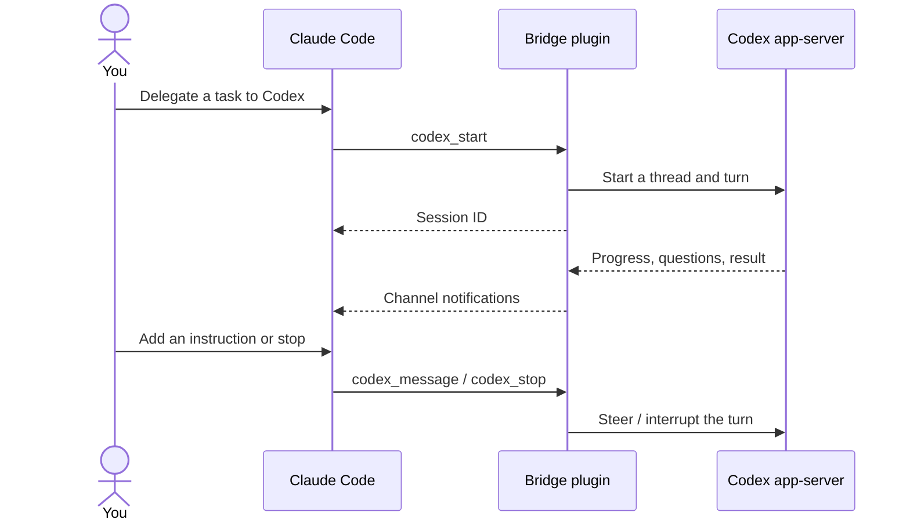

[](https://glama.ai/mcp/servers/umum-ai/claude-codex-bridge)

# Claude Codex Bridge

Run OpenAI Codex agents from Claude Code. Ask Claude to delegate a task to
Codex, follow its progress, send another instruction while it works, stop it,
or continue a saved session.

The plugin connects Claude's MCP tools and Channels to `codex app-server`.
Codex tasks run asynchronously; starting a task returns its session ID without
waiting for the task to finish.



## Requirements

- **Claude Code 2.1.261**, installed and signed in.
- **Codex CLI 0.153.4**, installed and signed in with access to the model you
  want to use.
- **Node.js 24.20.0 or newer**, including npm and npx.

These are the tested versions. Older versions are unsupported; compatibility
with newer versions must be verified. The plugin uses the experimental Codex
app-server protocol and Claude Code Channels research preview.

`node`, `npx`, and `codex` must be on the `PATH` inherited by Claude Code. The npm
package includes the bridge's JavaScript dependencies. The plugin
uses `npx` to fetch its exact package version on first startup; subsequent
starts use npm's cache. No source build or protocol generation is required.

## Install

### 1. Check the required tools

Install [Claude Code](https://code.claude.com/docs/en/quickstart),
[Codex CLI](https://developers.openai.com/codex/cli/), and
[Node.js](https://nodejs.org/en/download), then check:

```sh
claude --version
codex --version
node --version
npm --version
codex login status
```

If Codex is not signed in, run `codex login`. Claude and Codex use their own
accounts and model access. The plugin does not provide a subscription or API
credits.

### 2. Add the marketplace and install the plugin

```sh
claude plugin marketplace add umum-ai/claude-codex-bridge
claude plugin install claude-codex-bridge@claude-codex-bridge --scope user
```

Claude installs the plugin from this repository's marketplace. The plugin
starts the pinned version of
[`@kvokka/claude-codex-bridge`](https://www.npmjs.com/package/@kvokka/claude-codex-bridge)
with `npx --yes`. The first startup needs access to the npm registry.

### 3. Enable the plugin and Channels

Merge this into `~/.claude/settings.json`, keeping your other settings:

```json
{
  "channelsEnabled": true,
  "extraKnownMarketplaces": {
    "claude-codex-bridge": {
      "source": {
        "source": "github",
        "repo": "umum-ai/claude-codex-bridge"
      }
    }
  },
  "enabledPlugins": {
    "claude-codex-bridge@claude-codex-bridge": true
  }
}
```

The installation commands already register the marketplace and enable the
plugin. The complete fragment above also shows how to reproduce the settings.

### 4. Start Claude in your project

```sh
cd /absolute/path/to/your/project
claude
```

The maintainer reports that `channelsEnabled: true` enables this ordinary
startup on Claude Code 2.1.261 without a shell alias or wrapper. Channel
activation can also depend on your account and organization policy. Verify
incoming progress with the example below before relying on it.

Anthropic's [Channels documentation](https://code.claude.com/docs/en/channels#enterprise-controls)
currently describes `channelsEnabled` as a managed setting and requires
per-session opt-in. If tools load but incoming progress does not arrive, see
[Channels troubleshooting](#tools-work-but-live-progress-does-not-arrive).

## Use it

Talk to Claude normally. Give Codex a concrete task, the project directory, and
an explicit model when you want one:

> Use the bridge to start Codex with model gpt-5.6-luna in
> /absolute/path/to/my-project. Review the authentication code and suggest a
> fix for the failing login test. Report its progress as channel events arrive.

To check that notifications work, use a task with a short delay:

> Start Codex in this project. Ask it to announce that it started, run a command
> that waits 15 seconds, and then reply BRIDGE_DONE. Wait for channel events;
> do not poll codex_status or codex_events.

While Codex is working:

> Tell that Codex session to focus on the token refresh path.

To interrupt it:

> Ask that Codex session to stop.

After a task completes:

> Continue that Codex session: implement the proposed fix and run the relevant
> tests.

Keep the `threadId` if you want to continue after restarting Claude:

> Resume Codex thread THREAD_ID in /absolute/path/to/my-project, then ask it to
> continue the investigation.

Claude can list available models with `codex_models`. An explicitly selected
model is requested without provider fallback. Ask for a service tier such as
`fast` to override the `service_tier` in your Codex config for that thread.

Ask for a reasoning effort such as `high` when starting a task, or for a
different model or effort when sending the next message:

> Continue that Codex session with model gpt-5.6-luna and high effort: implement
> the proposed fix.

A new model or effort stays the thread's default for later turns. Codex cannot
change either for a turn in progress, so the bridge refuses them while a turn
is running.

Without a model or effort, a new thread uses `model` and
`model_reasoning_effort` from your Codex config (`~/.codex/config.toml`). The
Codex app and TUI rewrite those settings whenever you change model or effort
there, so the bridge would follow your last choice in the app. To give the
bridge its own defaults, set `CODEX_BRIDGE_MODEL` and `CODEX_BRIDGE_EFFORT` in
the environment Claude Code starts from, for example
`CODEX_BRIDGE_MODEL=gpt-6.1-sol CODEX_BRIDGE_EFFORT=high claude`. They apply
when `codex_start` omits a model or effort, and the default effort applies
whatever the model. The bridge sends them as overrides when it creates the
thread, so they stay the thread's own for later turns and resumes, and never
change your Codex config. Unset leaves the choice to the Codex config; an empty
value stops the server from starting. `codex_resume` does not use them: a
resumed thread keeps its own last model and effort.

Ask for a `read-only` or `workspace-write` sandbox to restrict a thread:

> Start Codex with a read-only sandbox in /absolute/path/to/my-project and
> review the authentication code.

Ask for an approval policy to have Codex ask before it goes beyond the sandbox.
Claude shows you each request and waits for your decision:

> Start Codex in /absolute/path/to/my-project with a workspace-write sandbox
> and the on-request approval policy, and fix the failing login test.

## Relay mode

The plugin ships an opt-in output style, `codex-relay`, that makes Claude a thin
relay to Codex. Claude sends each task to one persistent Codex thread with the
context Codex needs, reports progress, and passes Codex's answers through close
to verbatim. Codex does the reading, reasoning, and editing. Claude still steers
or stops the running turn when you ask, and brings Codex's questions to you
rather than answering them itself.

Select it in the terminal with `/output-style claude-codex-bridge:codex-relay`,
or from `/config` under **Output style**. Claude follows the style from your
next message. The desktop app has no output style menu, so set it in a settings
file there:

```json
{
  "outputStyle": "claude-codex-bridge:codex-relay"
}
```

Use `.claude/settings.local.json` for one project or `~/.claude/settings.json`
for every project. The value is case-sensitive. After editing a settings file,
or right after installing the plugin, start a new session to pick up the style.

The style leaves out Claude Code's built-in software engineering instructions
where Claude Code uses its full system prompt; its shorter system prompt never
includes them. Since Codex does the coding, run the relay session on a cheaper
Claude model such as Sonnet: start it with `claude --model sonnet` or switch
with `/model sonnet`.

## Available tools

| Tool | What you can ask Claude to do |
| --- | --- |
| `codex_models` | List the models available to Codex. |
| `codex_start` | Start an independent task in an absolute project directory. |
| `codex_message` | Send an instruction during a turn, or start the next turn. |
| `codex_stop` | Interrupt the current turn. |
| `codex_resume` | Reopen a saved Codex thread. |
| `codex_answer` | Answer a structured question from Codex. |
| `codex_approve` | Pass your decision on a Codex approval request. |
| `codex_status` | Read status, pending questions and approvals, and the latest answer. |
| `codex_events` | Read recent events using a sequence cursor. |

## How it works

Claude starts the plugin as an MCP server. The plugin starts a local
`codex app-server` process and uses its stdio protocol to manage Codex sessions.
Control calls return promptly; the task continues inside Codex. This does not
use a long-running Claude Bash tool call, and task duration is independent of
Claude's Bash timeout. Control acknowledgements have a 30-second timeout.

Codex progress, questions, errors, and completion arrive through Claude
Channels. Claude processes queued notifications when it can take its next
turn. A successful notification write does not confirm that Claude has read it.
Codex sessions appear through tools and messages, not as native Claude agents
in its subagent panel.

**By default, Codex runs with `danger-full-access` and `approvalPolicy: never`.**
It can modify files and run commands with the permissions of your local user
without requesting approval. Claude's tool permissions do not sandbox Codex.
Choose the project directory and tasks with that execution mode in mind.

`codex_start` and `codex_resume` accept these optional settings:

| Setting | Values | Default | Environment variable |
| --- | --- | --- | --- |
| `sandbox` | `read-only`, `workspace-write`, `danger-full-access` | `danger-full-access` | `CODEX_BRIDGE_SANDBOX` |
| `approvalPolicy` | `untrusted`, `on-request`, `never` | `never` | `CODEX_BRIDGE_APPROVAL_POLICY` |
| `approvalsReviewer` | `user`, `auto_review` | not sent: Codex uses its configured reviewer | `CODEX_BRIDGE_APPROVALS_REVIEWER` |

With `approvalPolicy: never`, Codex never asks, so a command that needs more
than the sandbox allows fails. `on-request` lets Codex ask to go beyond the
sandbox, for example for network access; `untrusted` asks before any command
Codex does not know to be safe.

`approvalsReviewer` chooses who answers those requests. With `user`, each
request reaches Claude as an `approval` event with the command, the proposed
diff or the requested permissions. The turn waits with status
`waiting_approval` until Claude passes your decision with `codex_approve`:
`accept`, `acceptForSession`, `decline`, or `cancel` (decline and interrupt the
turn). `codex_approve` cannot send Codex's `acceptWithExecpolicyAmendment` or
`applyNetworkPolicyAmendment` decisions, so a command request that offers them
can only be accepted plainly, if it also offers `accept` or `acceptForSession`,
or refused. A request answered elsewhere, such as in another client of the same
Codex app-server, or left open when the turn ends, is cleared. With
`auto_review`, a Codex reviewer agent decides, and the bridge reports each
decision as an `auto_review` event.

The bridge tells Claude never to approve on its own judgment. To have Claude
Code also ask you before every `codex_approve` call, whatever the permission
mode, add an `ask` rule to your Claude Code settings, for example
`~/.claude/settings.json`:

```json
{
  "permissions": {
    "ask": ["mcp__plugin_claude-codex-bridge_codex-bridge__codex_approve"]
  }
}
```

Ask rules take precedence over allow rules, and Claude Code prompts for them
even in `bypassPermissions` mode. If you run the server directly with
`mise run claude`, the tool is `mcp__codex-bridge__codex_approve` instead.

To change a default, set its environment variable in the environment Claude
Code starts from, for example
`CODEX_BRIDGE_SANDBOX=workspace-write CODEX_BRIDGE_APPROVAL_POLICY=on-request claude`.
The bridge refuses to start when one of these variables is set to an empty or
unknown value.

`CODEX_BRIDGE_SANDBOX` also limits Codex regardless of what Claude asks for: the
mode it names is both the default and the widest allowed. The bridge refuses a
`sandbox` wider than it (`read-only` < `workspace-write` < `danger-full-access`)
and accepts a narrower one. The cap applies to the sandbox mode only: with an
`approvalPolicy` other than `never`, a request that you or the `auto_review`
reviewer approve can still let a single command run beyond the sandbox. The
approval variables set defaults only, so Claude can still ask for another
`approvalPolicy` or `approvalsReviewer`.

A thread keeps its settings while the bridge has it attached, and
`codex_resume` with a different value is an error. The bridge does not save a
thread's settings, so after the bridge restarts, `codex_resume` uses the
defaults for any setting it omits, not the values the thread started with.

The plugin uses Codex's existing authentication and configuration. It adds no
API proxy, model impersonation, interception hook, or global timeout override.
By default, exiting Claude stops the bridge and its private app-server process,
which ends any running turn. Saved Codex threads can be resumed. To keep turns
running after Claude exits, use the
[shared Codex daemon](#keep-tasks-running-after-claude-exits).

Progress is batched about once a second and capped at 8,000 characters per
batch. The bridge retains 200 recent events across sessions and up to 64,000
characters of the latest answer. Truncation and an expired event cursor are
reported explicitly. The event journal lives only for the current bridge
process.

## Without Channels

Channels is a research preview. It needs `channelsEnabled` or the development
channel flag, and it is not documented for the Claude desktop app. The bridge
can also append every event to a file that Claude follows with its
[Monitor tool](https://code.claude.com/docs/en/tools-reference#monitor-tool).
Monitor is not available on Amazon Bedrock, Google Cloud's Agent Platform, or
Microsoft Foundry, or when `DISABLE_TELEMETRY` or
`CLAUDE_CODE_DISABLE_NONESSENTIAL_TRAFFIC` is set.

Set `CODEX_BRIDGE_EVENT_LOG_DIR` to an absolute directory that only you can
write, in the `env` block of `~/.claude/settings.json`. Claude Code passes it to
the plugin's server:

```json
{
  "env": {
    "CODEX_BRIDGE_EVENT_LOG_DIR": "/home/you/.cache/claude-codex-bridge"
  }
}
```

Exporting the variable in the shell that launches `claude` also works. Restart
Claude after changing it.

Each bridge process creates its own file in that directory,
`codex-bridge-<start time>-<pid>.jsonl`, so concurrent Claude sessions never
share one. The bridge creates the directory and file readable only by you, since
events can include command output; it refuses a file that already exists at the
path. Each line is one JSON event with the same `sequence`, `threadId`, `kind`,
`text`, `truncated`, and `timestamp` that `codex_events` returns. Channel
notifications are still sent.

The server's instructions give Claude the file path. Claude follows it with
`tail -n 0 -F <file>` in Monitor. Monitor stops at its deadline. Before
re-arming it, Claude checks `codex_status` for a new `eventLog` path, which
means the bridge restarted. It then reads missed events with `codex_events`
after the last sequence it saw, or from the file when `codex_events` reports a
gap. An empty or relative directory stops the server from starting. A failed
write does not stop the bridge or channel delivery; `codex_status` reports it
as `eventLogError`.

The bridge never truncates or deletes these files. A file grows by one line per
event for the life of its session. Event text is capped at 8,000 characters, so
a line can exceed 8 KB after UTF-8 and JSON escaping. Progress is written at
most once a second per running thread. Delete files from sessions that have
ended.

## Keep tasks running after Claude exits

Codex can run a shared local app-server daemon. Start it, then start Claude
with `CODEX_BRIDGE_APP_SERVER=daemon`:

```sh
codex app-server daemon start
CODEX_BRIDGE_APP_SERVER=daemon claude
```

The bridge then connects through `codex app-server proxy` instead of starting
its own app-server. Its turns run in the daemon:

- Exiting Claude closes only the bridge's connection. Running turns continue.
- Another Claude session can call `codex_resume` with the `threadId` while the
  turn is still running. It receives the turn's live progress from then on and
  can steer it with `codex_message`.
- `codex agents` lists the daemon's threads, including the bridge's, and can
  open them. The Codex desktop app does not use the daemon, so it does not show
  these turns.
- The daemon unloads a thread 30 minutes after its last connection leaves it.
  Whether a running turn survives that with no connection attached is untested.

If the connection to the daemon drops, for example because the daemon
restarted, the bridge marks its sessions `unavailable`. The next
`codex_models`, `codex_start`, `codex_message`, `codex_stop` or `codex_resume`
call opens a new connection and resumes those sessions, taking their status
from the daemon. Questions Codex asked on the dropped connection are lost and
cannot be answered. If the daemon is not running, Codex tools fail with a
connection error, and each later call tries to connect again.

Run `codex app-server daemon version` to check the daemon and
`codex app-server daemon stop` to stop it. Starting the daemon also starts a
Codex updater that installs updates on a schedule and restarts the daemon to
apply them, which can interrupt a running turn. The updater keeps running after
`daemon stop`. Stopping or restarting the daemon yourself can also interrupt
running turns.

## Update or uninstall

To install the latest published version:

```sh
claude plugin marketplace update claude-codex-bridge
claude plugin update claude-codex-bridge@claude-codex-bridge
```

Restart Claude after updating. To remove the plugin:

```sh
claude plugin uninstall claude-codex-bridge@claude-codex-bridge --scope user
claude plugin marketplace remove claude-codex-bridge
```

## Why yet another connector?

[codex-mcp](https://github.com/kvokka/codex-mcp)
[explains](https://github.com/kvokka/codex-mcp/blob/master/docs/COMPARISON.md)
why existing solutions on the market fall short, and why a straightforward
approach was needed.

I checked all the boxes, but the implementation ended up large and clumsy.

This version is ~14× smaller (10 321 LOC in `codex-mcp` v3.1.0 vs 746 LOC in
`claude-codex-bridge` v0.1.2), more stable, clearer, and cleaner. It builds on
Claude Code Channels — still experimental, but solid enough in practice.

It has the same limitations and the same feature set as `codex-mcp`.

I only arrived at this design after shipping `codex-mcp`. The idea isn’t new: it
was already implemented in
[codex-claude-bridge](https://github.com/abhishekgahlot2/codex-claude-bridge).
That project is unmaintained, and this architecture fixes several of its flaws.

## Releases

A release is chosen manually with exactly one `release:patch`, `release:minor`,
or `release:major` label on a pull request. It runs when the PR merges into
`main`, or when the label is added to an already merged PR. An unlabeled PR
publishes nothing.

The release updates the npm package version, both root versions in
`package-lock.json`, the plugin manifest, the marketplace entry, and the npm
version in the plugin's launch command together. It checks the resulting
commit before pushing `main` and the `X.Y.Z` git tag atomically, then publishes
the verified npm archive with provenance and creates the GitHub release. If `main`
moves during the checks, the release stops before tagging.

For a failed publication, run the `release` workflow manually with its existing
`X.Y.Z` tag as `ref`. This retries that version without another bump. An npm
version already carrying the same archive is left in place; different bytes are
rejected.

The npm package owner must configure a
[trusted publisher](https://docs.npmjs.com/trusted-publishers/) for GitHub owner
`umum-ai`, repository `claude-codex-bridge`, workflow `release.yml`, and environment
`npm`. The first publication uses the repository's short-lived `NPM_TOKEN` secret.
After the package exists and its trusted publisher is configured, npm uses
GitHub OIDC; the token can expire or be removed. The token is passed only to the
publication step.

## Troubleshooting

### Tools work but live progress does not arrive

Tool availability and incoming channel delivery have separate gates. Use
`codex_status` to confirm the task is running and check Claude's startup notices
for a channel or organization-policy warning. Where Channels cannot be enabled,
use the [event log file](#without-channels).

For testing this custom channel, start a session with:

```sh
claude --dangerously-load-development-channels plugin:claude-codex-bridge@claude-codex-bridge
```

This explicit preview flag is the integration-tested path for incoming events.
The plugin is not on Anthropic's official channel allowlist. An organization can
approve it in managed settings with `channelsEnabled: true` and an
`allowedChannelPlugins` entry naming marketplace `claude-codex-bridge` and
plugin `claude-codex-bridge`; an approved session uses
`--channels plugin:claude-codex-bridge@claude-codex-bridge`. Preserve any other
channels on the organization's allowlist.

### The MCP server fails to start

Check that `node --version`, `npm --version`, and `codex --version` work in
the same terminal where
you launch Claude. Restart Claude after installing either tool or changing
`PATH`. Use `/mcp` in Claude to inspect the server connection.

### Codex rejects the model or account

Run `codex login status` and ask Claude to call `codex_models`. Model access is
controlled by your Codex account. A requested model error is surfaced directly.
If every `codex_start` fails this way, check `CODEX_BRIDGE_MODEL` and
`CODEX_BRIDGE_EFFORT`: the bridge passes them to Codex unchecked. Codex accepts
any effort when it creates a thread, so a bad `CODEX_BRIDGE_EFFORT` still
leaves a thread, and the error names it. Fix the variable and restart Claude,
or ask Claude to continue that thread with `codex_message` and a valid effort.
A thread you don't continue stays in your Codex thread list; archive it in
the Codex app if you don't want it.

### A task disappeared after restarting Claude

Ask Claude to call `codex_resume` with the saved `threadId` and project directory.
The event journal does not survive a restart; the saved Codex conversation does.

Report reproducible problems at
[GitHub Issues](https://github.com/umum-ai/claude-codex-bridge/issues), including
the tool versions, the failed operation, and relevant error messages.
Remove credentials and private project content from reports.
